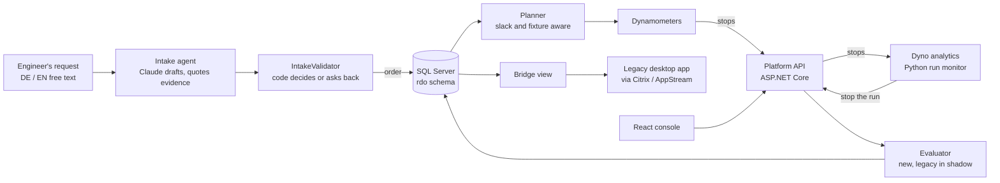
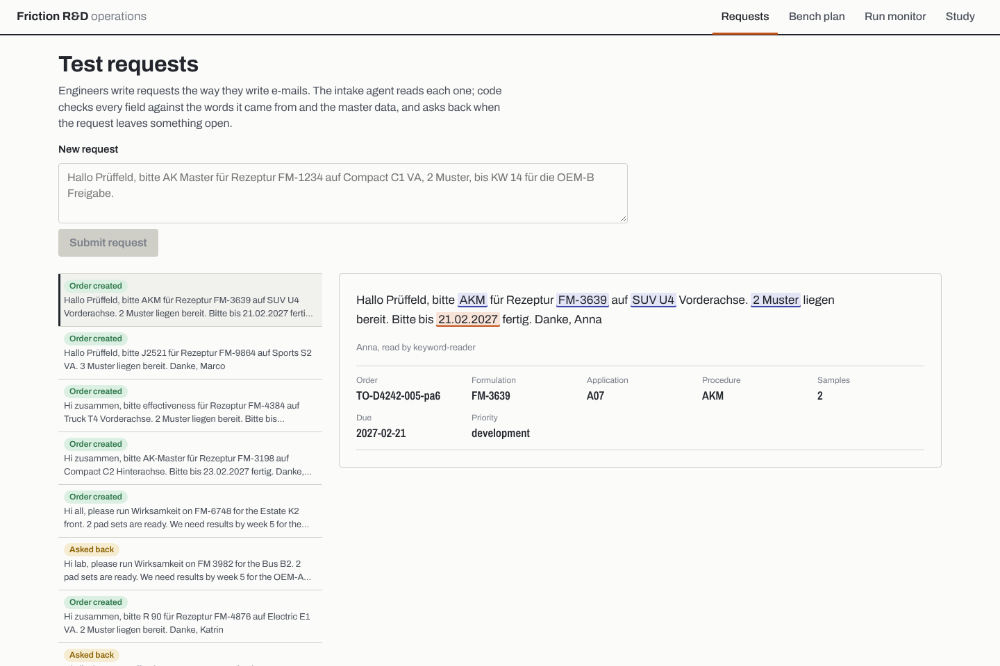
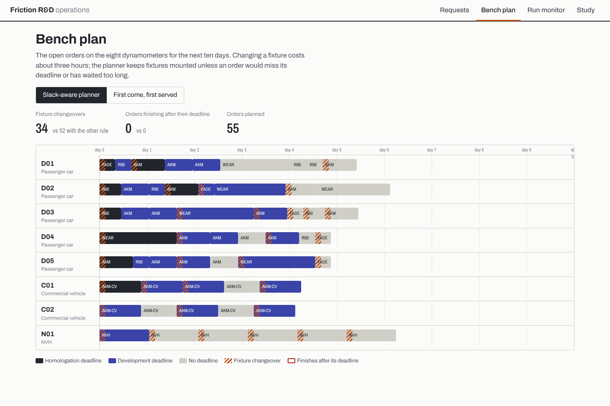
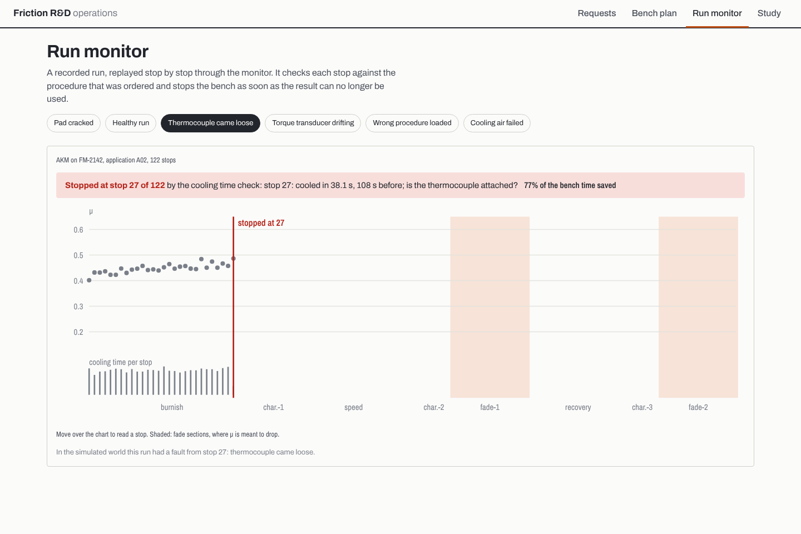
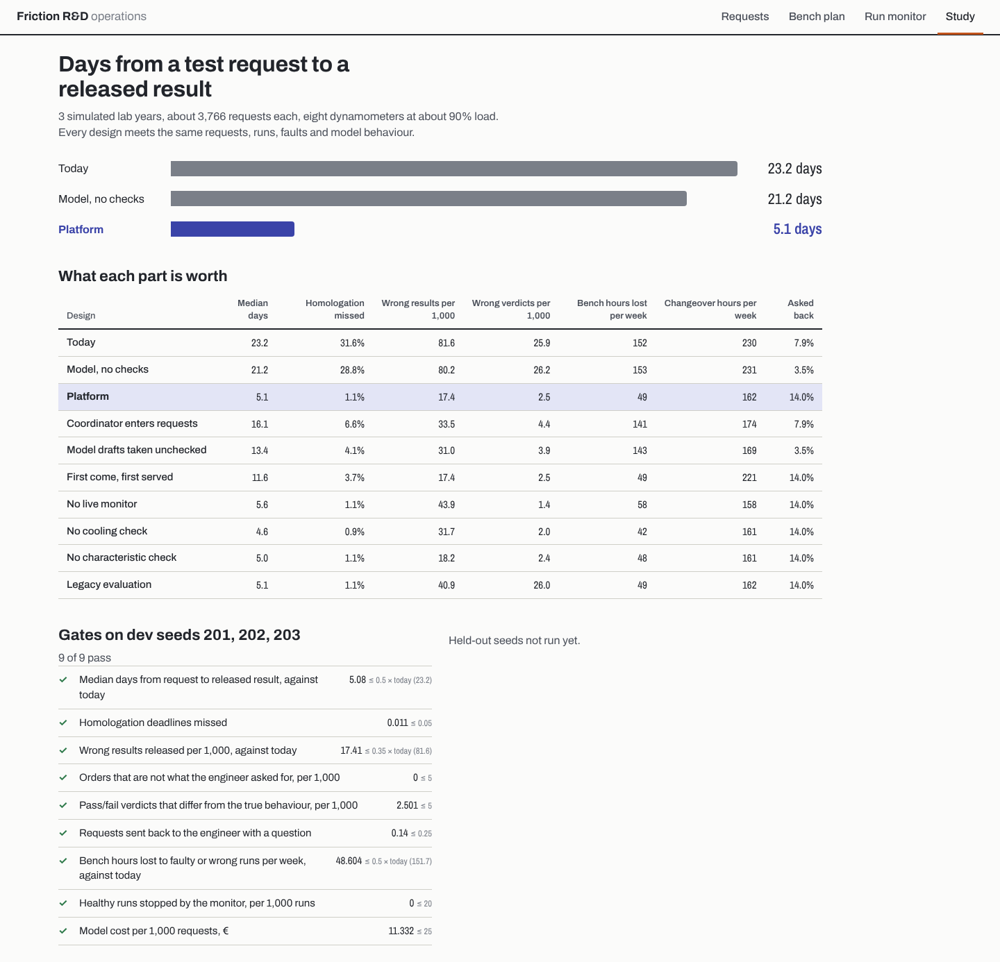

# friction-rd-platform

An R&D operations platform for a brake friction materials lab, and the plan to modernize it. Engineers
request dynamometer tests for new pad formulations; the platform turns each request into a checked
order, plans it onto the benches, watches the run stop by stop, evaluates the friction result, and
keeps the legacy desktop application working while it is replaced.

- **C#/.NET 8 and SQL Server**: an ASP.NET Core API, the planner, intake validation and the friction
  evaluators, a line-by-line port of the legacy evaluation, and additive SQL Server migrations with
  a bridge so the legacy application keeps reading platform orders.
- **Python**: the dyno analytics service that checks runs live (FastAPI), and the simulated lab that
  measures every design.
- **React**: a console for requests, the bench plan, the run monitor and the study.
- **AI**: an intake agent (Claude via the Messages API) that drafts orders from free-text requests in
  German and English, quoting its evidence; code decides.
- **AWS**: containers for ECS Fargate, RDS for SQL Server, AppStream 2.0 for the legacy application
  during the move ([deployment notes](docs/aws-architecture.md)).

## Results

<!-- results:start -->
Dev: 3 simulated lab years, about 3,766 test requests each, 8 dynamometers at about 90% load. Every design meets the same requests, runs, faults and model behaviour. **9 of 9 gates pass.**

| | Today | Model alone | Platform |
|---|---:|---:|---:|
| Median days from request to result | 23.2 | 21.2 | **5.1** |
| Homologation deadlines missed | 31.6% | 28.8% | **1.1%** |
| Wrong results released per 1,000 | 81.6 | 80.2 | **17.4** |
| Orders that are not what was asked, per 1,000 | 80.1 | 83.7 | **0.0** |
| Bench hours lost to faulty or wrong runs, per week | 152 | 153 | **49** |
| Fixture changeover hours per week | 230 | 231 | **162** |
| Coordinator hours per week entering requests | 11.8 | 0.2 | **0.6** |
| Model cost per 1,000 requests | €0 | €10.27 | **€11.33** |

**What each part is worth** (each row changes one part of the platform)

| Design | Median lead time, days | p90 lead time, days | Homologation deadlines missed | Wrong results per 1,000 | Wrong orders per 1,000 | Wrong verdicts per 1,000 | Bench hours lost per week | Changeover hours per week | Coordinator hours per week | Asked back |
|---|---:|---:|---:|---:|---:|---:|---:|---:|---:|---:|
| Today: coordinator enters requests, first come first served, results reviewed after the run, legacy evaluation | 23.2 | 42.0 | 31.6% | 81.6 | 80.1 | 25.9 | 152 | 230 | 11.8 | 7.9% |
| A language model turns requests into orders with no checks; everything else as today | 21.2 | 40.5 | 28.8% | 80.2 | 83.7 | 26.2 | 153 | 231 | 0.2 | 3.5% |
| **Platform: intake agent with code checks, slack-aware planner, live run monitor, new evaluator** | 5.1 | 9.5 | 1.1% | 17.4 | 0.0 | 2.5 | 49 | 162 | 0.6 | 14.0% |
| Platform with requests entered by the coordinator | 16.1 | 25.5 | 6.6% | 33.5 | 80.1 | 4.4 | 141 | 174 | 11.8 | 7.9% |
| Platform with the model's drafts taken without code checks | 13.4 | 23.2 | 4.1% | 31.0 | 83.7 | 3.9 | 143 | 169 | 0.2 | 3.5% |
| Platform with first come, first served bench planning | 11.6 | 20.0 | 3.7% | 17.4 | 0.0 | 2.5 | 49 | 221 | 0.6 | 14.0% |
| Platform without the live run monitor (review after the run) | 5.6 | 10.0 | 1.1% | 43.9 | 0.0 | 1.4 | 58 | 158 | 0.6 | 14.0% |
| Platform monitor without the cooling-time check | 4.6 | 8.9 | 0.9% | 31.7 | 0.0 | 2.0 | 42 | 161 | 0.6 | 14.0% |
| Platform monitor without the characteristic-section check | 5.0 | 9.4 | 1.1% | 18.2 | 0.0 | 2.4 | 48 | 161 | 0.6 | 14.0% |
| Platform still evaluating with the legacy calculation | 5.1 | 9.5 | 1.1% | 40.9 | 0.0 | 26.0 | 49 | 162 | 0.6 | 14.0% |

**Modernization parity:** on runs the new and the legacy evaluator both scored, they differ beyond rounding on 38.7%: the legacy fade loop skips the last fade stop, which is usually the hottest. With the legacy calculation the platform releases 26.0 wrong pass/fail verdicts per 1,000 results; with the new one, 2.5.

**Gates (dev)**

| Gate | Value | Limit | |
|---|---:|---|---|
| Median days from request to released result, against today | 5.08 | ≤ 0.5 × today (23.2) | pass |
| Homologation deadlines missed | 0.011 | ≤ 0.05 | pass |
| Wrong results released per 1,000, against today | 17.41 | ≤ 0.35 × today (81.6) | pass |
| Orders that are not what the engineer asked for, per 1,000 | 0.0 | ≤ 5 | pass |
| Pass/fail verdicts that differ from the true behaviour, per 1,000 | 2.501 | ≤ 5 | pass |
| Requests sent back to the engineer with a question | 0.14 | ≤ 0.25 | pass |
| Bench hours lost to faulty or wrong runs per week, against today | 48.604 | ≤ 0.5 × today (151.7) | pass |
| Healthy runs stopped by the monitor, per 1,000 runs | 0.0 | ≤ 20 | pass |
| Model cost per 1,000 requests, € | 11.332 | ≤ 25 | pass |

**Held-out (2 further lab years, run once after the design was frozen): 9 of 9 gates pass.** Median lead time 20.5 → 4.6 days; wrong results per 1,000 85.2 → 17.9; homologation deadlines missed 23.7% → 2.3%.

| Gate | Value | Limit | |
|---|---:|---|---|
| Median days from request to released result, against today | 4.571 | ≤ 0.5 × today (20.5) | pass |
| Homologation deadlines missed | 0.023 | ≤ 0.05 | pass |
| Wrong results released per 1,000, against today | 17.902 | ≤ 0.35 × today (85.2) | pass |
| Orders that are not what the engineer asked for, per 1,000 | 0.0 | ≤ 5 | pass |
| Pass/fail verdicts that differ from the true behaviour, per 1,000 | 2.693 | ≤ 5 | pass |
| Requests sent back to the engineer with a question | 0.128 | ≤ 0.25 | pass |
| Bench hours lost to faulty or wrong runs per week, against today | 48.256 | ≤ 0.5 × today (139.9) | pass |
| Healthy runs stopped by the monitor, per 1,000 runs | 0.245 | ≤ 20 | pass |
| Model cost per 1,000 requests, € | 11.164 | ≤ 25 | pass |

<!-- results:end -->

## Architecture



| Concern | Choice | Decision |
|---|---|---|
| Modernization | Strangle the legacy application; additive `rdo` schema; bridge view and one-time import | [ADR 1](docs/adr/0001-strangler-not-rewrite.md) |
| Evaluation | Port the legacy calculation, run the new one in shadow, report parity | [ADR 2](docs/adr/0002-evaluation-parity-gate.md) |
| Intake | The model drafts with evidence; code accepts, retries once with findings, or asks the engineer | [ADR 3](docs/adr/0003-intake-agent-code-decides.md) |
| Runs | Live checks against the ordered procedure; a monitor outage never stops a bench | [ADR 4](docs/adr/0004-live-run-monitor.md) |
| Planning | Least slack first when a deadline is at risk; otherwise keep the mounted fixture | [ADR 5](docs/adr/0005-planner-slack-and-fixtures.md) |
| Evidence | A simulated lab that drives the real C# core; same luck for every design; held-out run once | [ADR 6](docs/adr/0006-lab-drives-the-real-core.md) |

External partners work to [the partner playbook](docs/partner-playbook.md): contracts first,
additive migrations, parity before switching, the lab as the regression suite, all CI jobs green.

## The lab

- **The world** (`analytics/src/dynolab/world`) is a friction lab: 8 dynamometers (passenger car,
  commercial vehicle, NVH), about 30 brake applications with their fixtures, 140 formulations with
  their true friction behaviour (bedding, speed sensitivity, fade onset and depth, how a pad settles
  after fade), and seven procedures, among them an AK Master style effectiveness test and a
  customer's own variant of it. A year brings about 3,800 requests, written as engineers write
  them, 60% in German: calendar weeks, missing axles, a second formulation code, unreleased mixes.
  Runs record every stop; 9% carry a fault (loose thermocouple, drifting torque transducer, wrong
  procedure loaded, failed cooling air, cracked pad) that leaves traces in the data.
- **The model** reading requests is simulated (`dynolab/lab/simmodel.py`): it sometimes takes a
  neighbouring code, guesses an axle, misses a customer variant, converts a week wrongly, or quotes
  words that are not there. Every draw is keyed by the request, so every design meets the same model.
- **Designs** (`config/designs.json`): today's process, a model with no checks, the platform, and
  seven variants of the platform that each change one part. Gates are in `config/gates.json`.

## Run it

```bash
python3.13 -m venv .venv && . .venv/bin/activate && pip install -e "analytics[dev]"
dotnet build Rdo.sln -c Release && dotnet test Rdo.sln          # SQL Server tests need RDO_TEST_SQLSERVER
pytest -q analytics
dynolab lab dev                                                  # ~4 min: every design on the dev seeds
dynolab lab dev --check                                          # the rerun must reproduce the numbers

docker compose up                                                # SQL Server, analytics, API with demo requests
cd web && npm ci && npm run dev                                  # console on :5173
```

```bash
curl -s localhost:8080/api/requests -H 'X-Api-Key: engineer-key' -H 'content-type: application/json' \
  -d '{"text": "Hallo Prüffeld, bitte AK Master für Rezeptur FM-1234 auf Compact C1 VA, bis KW 14 für die OEM-B Freigabe."}'
```

## Console

| Requests | Bench plan |
|---|---|
|  |  |
| **Run monitor** | **Study** |
|  |  |

## Repository

```
src/Rdo.Core/        domain, planner, intake (validator, agent, Claude adapter), evaluators, store interface
src/Rdo.Legacy/      the legacy evaluation, ported for parity
src/Rdo.Api/         ASP.NET Core API (requests, orders, schedule, runs, results), Dockerfile
src/Rdo.SqlServer/   SQL Server store, migrator, migrations (legacy schema, rdo schema, bridge)
src/Rdo.Cli/         rdo-core: the core over JSON lines, for the lab
tests/Rdo.Tests/     xUnit: parsing, intake, planner, evaluators, Claude adapter, API, SQL Server
analytics/           dynolab: run monitor service, the simulated world, the lab, reports
web/                 React console (Vite, Framer Motion, design tokens)
config/              platform.json, world.json, designs.json, gates.json, seeds.json, demo data
docs/                ADRs, AWS deployment, partner playbook, screenshots
```

## Limits

- **The lab, its requests, runs, faults and the reading model are simulated.** The numbers measure the
  platform against the problems modelled here, not against a real lab's data. A real start would
  replay a year of the lab's own requests and dyno files through the same study.
- **The procedures are simplified** versions of AK Master (SAE J2522) and SAE J2521 style tests, not
  the standards themselves, and the friction physics is a plausible model, not a validated one.
- **The legacy application here is a stand-in**: its schema and its evaluation (with two plausible
  defects) are written for this repository. A real port starts by recording the legacy outputs.
- **`ClaudeIntakeModel` is tested with a mocked HTTP handler**, not against the live API; without a
  key the service uses a keyword reader, which is not a language model.
- **The lab runs at about 90% bench load.** Lead times at that load react strongly to lost hours;
  at lower load the differences between designs are smaller.
- **Not built**: Terraform for AWS, single sign-on for people, the dyno software's integration, and
  AppStream itself (see the deployment notes).
